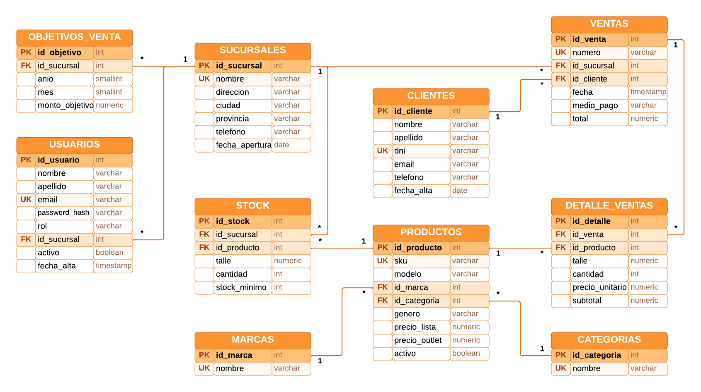
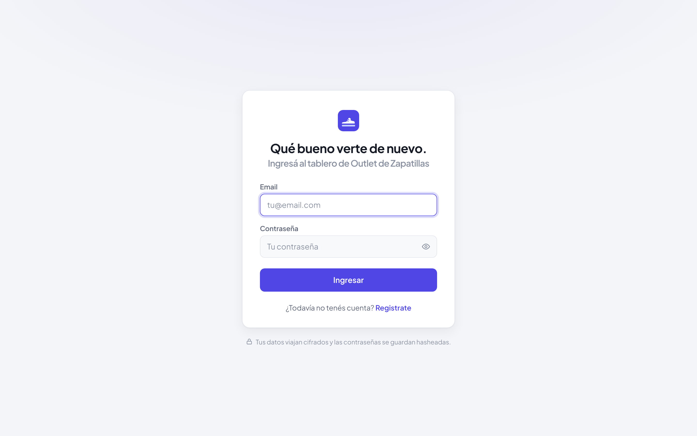
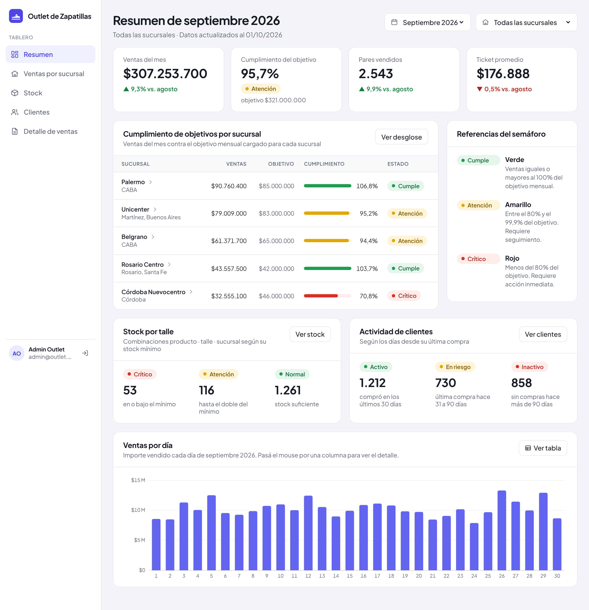
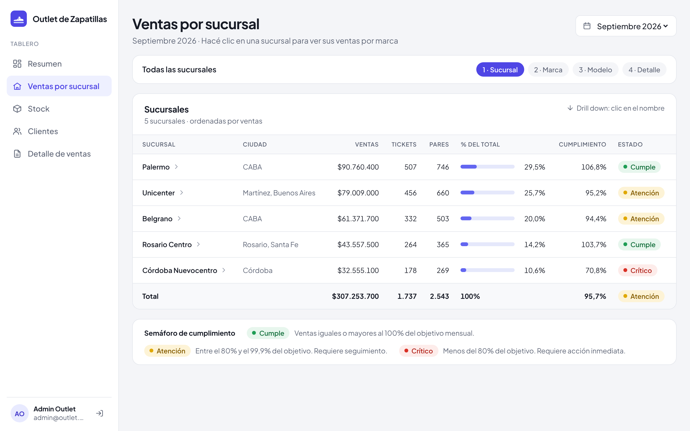
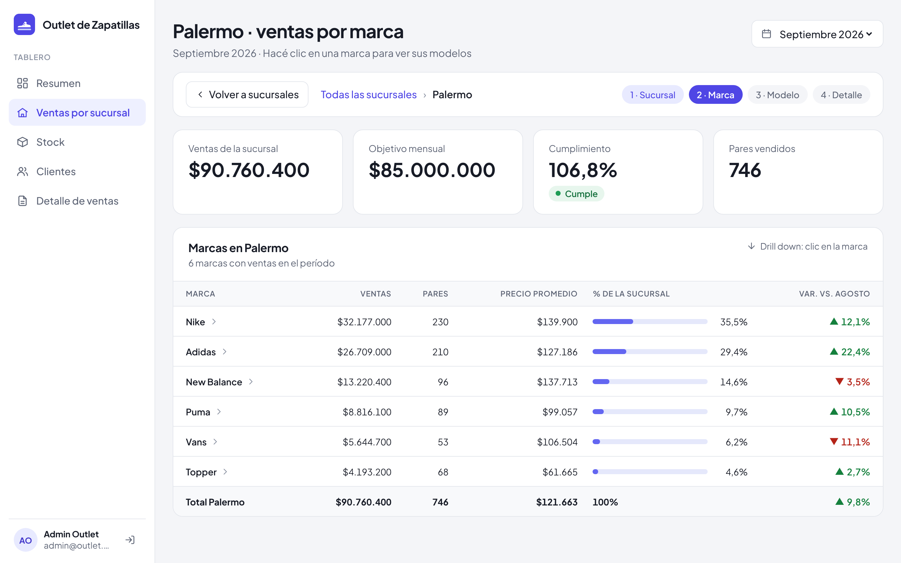
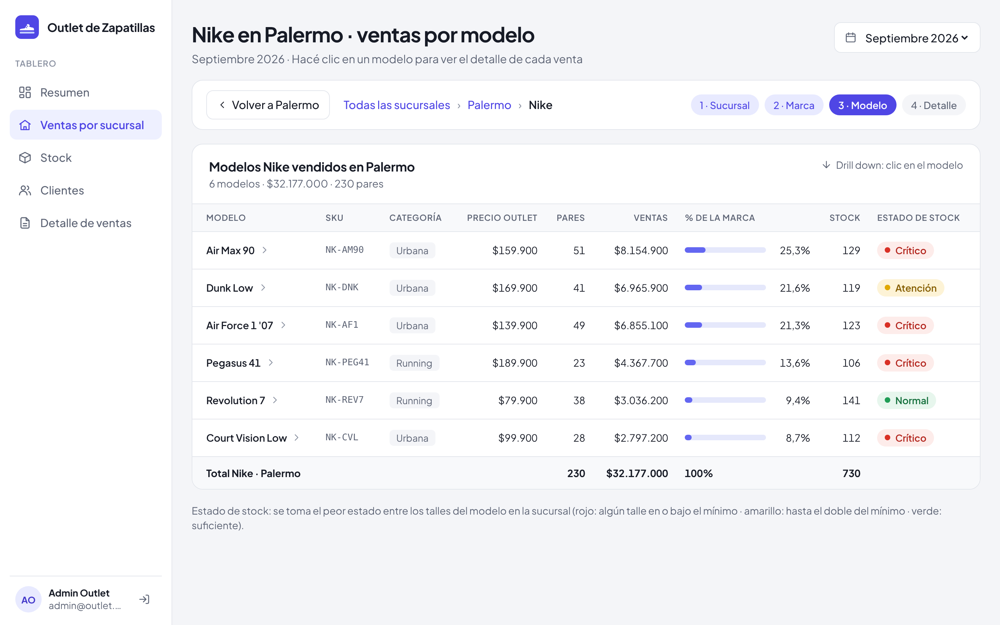
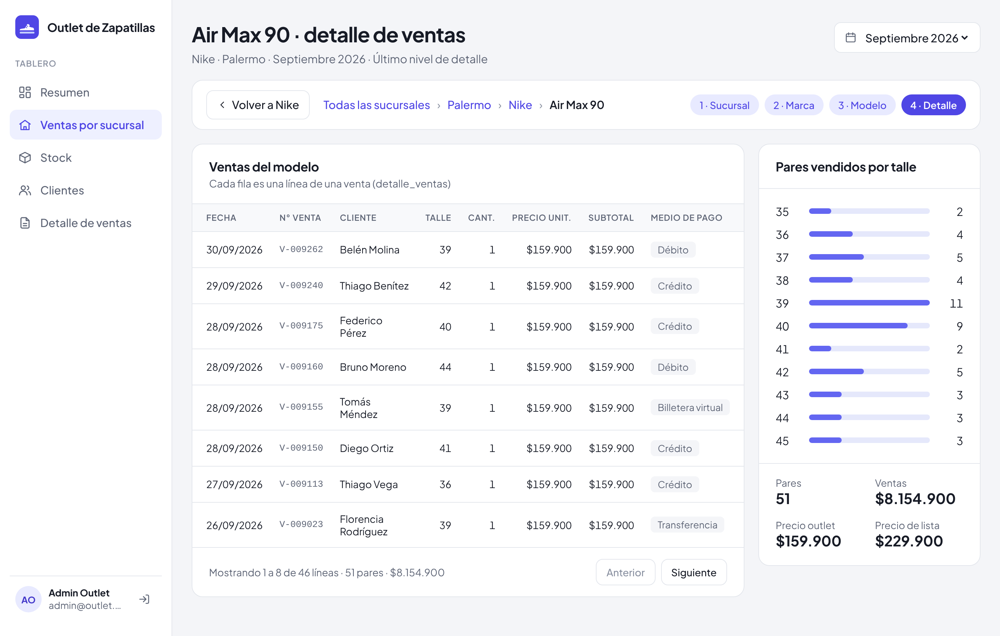
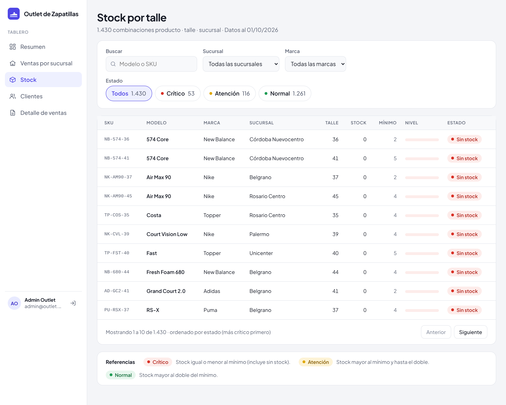
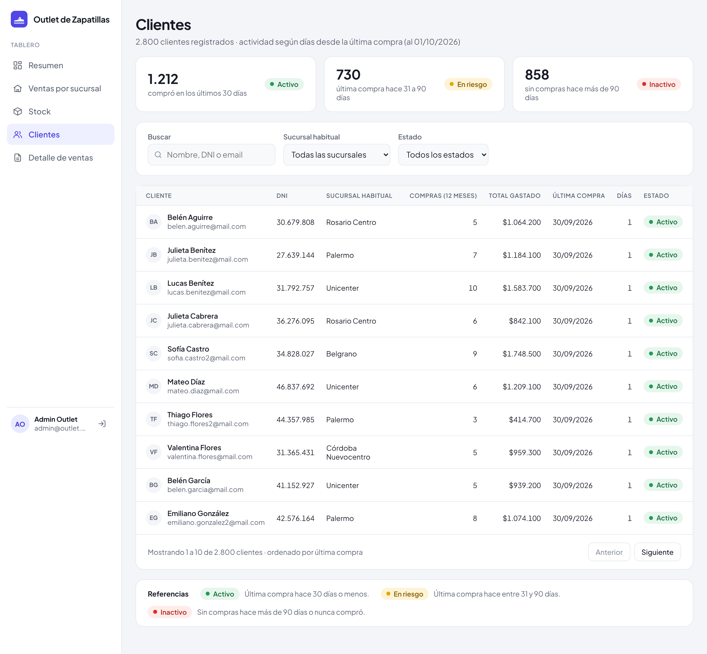
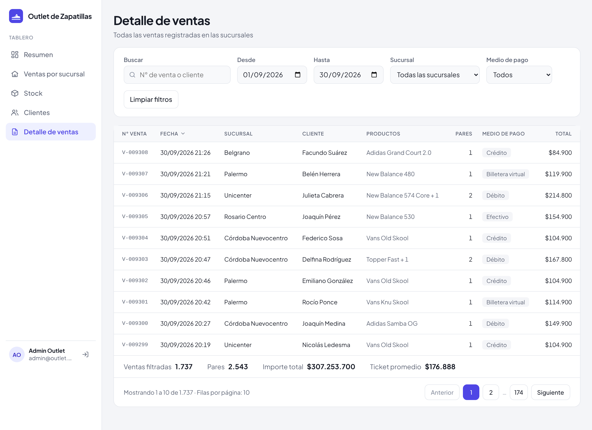

# Tablero de control para un outlet de zapatillas

Tablero de control (dashboard) web para una cadena de outlets de zapatillas con
varias sucursales, creado con **React**, **ASP.NET Core** y **PostgreSQL** para
la materia **Bases de Datos Aplicada**.

## Contenido

- **Documento de la entrega final**:
  **`docs/Entrega 2 - Leonel Blumberg y Luciano Migoni.pdf`** (se genera desde
  **`docs/entrega-2/documento.html`**, ver **`client/README.md`**).
- **Documento de la primera entrega** con el DER y el diccionario de datos:
  **`docs/Entrega 1 - Leonel Blumberg y Luciano Migoni.docx`**.
- **Contrato de la API** entre el frontend y el backend:
  **`docs/contrato-api.md`**. Tiene cada endpoint del tablero con sus
  parámetros, el JSON que devuelve y las reglas de los semáforos.
- **Diagrama entidad-relación** (Lucidchart) en **`docs/img/der.png`**.
- **Frontend** en **`client/`**: inicio de sesión, registro y las cinco
  pantallas del tablero (Resumen, Ventas por sucursal, Stock, Clientes y
  Detalle de ventas).
- **Backend** en **`server/`**: API de autenticación con token JWT y consultas
  del tablero.
- **Base de datos** en **`server/base de datos/`**: scripts SQL de creación de
  las 10 tablas, carga de datos de prueba (seis meses de ventas) y las
  funciones y vistas que calculan los semáforos.
- **Indicadores del mes**: ventas, cumplimiento del objetivo, pares vendidos y
  ticket promedio, con su variación contra el mes anterior.
- **Semaforización** de cumplimiento de objetivos, stock por talle y actividad
  de clientes, con tres estados (verde, amarillo y rojo) y su referencia en
  pantalla.
- **Drill down / drill up** en cuatro niveles: Sucursal › Marca › Modelo ›
  Detalle de ventas.
- **Mockups** (Figma) de la primera entrega en **`docs/img/mockups/`**.
- **Capturas** de todas las pantallas en **`docs/img/entrega2/`**.

## Requisitos previos

Para ejecutar el proyecto se necesita:

- **Node.js 20** o superior.
- **.NET SDK 10**.
- **PostgreSQL** corriendo en **`localhost:5432`** con el usuario
  **`postgres`** y la contraseña **`postgres`**.

Para usar otra contraseña de PostgreSQL, ver **`server/README.md`**.

## Configuración local

- Base de datos: **`outlet_zapatillas`**
- Backend: **`http://localhost:5000`**
- Frontend: **`http://localhost:5173`**

Para levantar el backend, ejecutar **`dotnet run`** dentro de
**`server/OutletApi`**. La primera vez crea la base, las tablas y los datos de
prueba.

Luego, en otra terminal, ejecutar **`npm install`** y **`npm run dev`** dentro
de **`client`**. Vite redirige las llamadas a **`/api`** al backend, así que no
hace falta configurar CORS.

Usuarios de prueba (solo para desarrollo):

- **`admin@outlet.com`** / **`Admin1234`**: rol admin.
- **`gerente@outlet.com`** / **`Gerente1234`**: rol gerente.

## Capturas

**Diagrama entidad-relación**

**Inicio de sesión**

**Resumen del mes**

**Drill down, nivel 1: ventas por sucursal**

**Drill down, nivel 2: ventas por marca**

**Drill down, nivel 3: ventas por modelo**

**Drill down, nivel 4: detalle de ventas del modelo**

**Stock por talle**

**Clientes**

**Detalle de ventas**

## Autores

**Leonel Maximiliano Blumberg**

**Luciano Galo Migoni**
