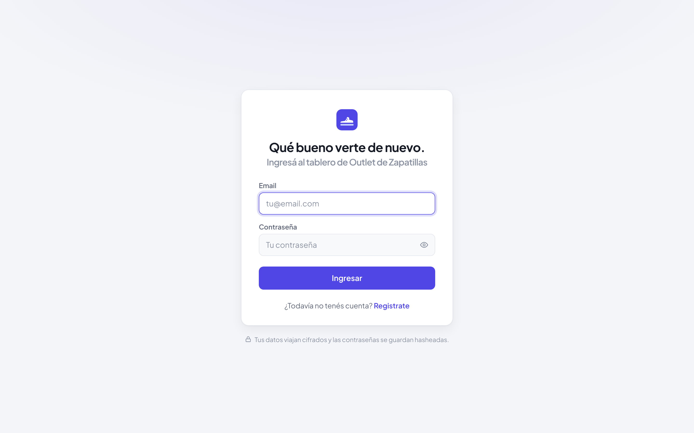
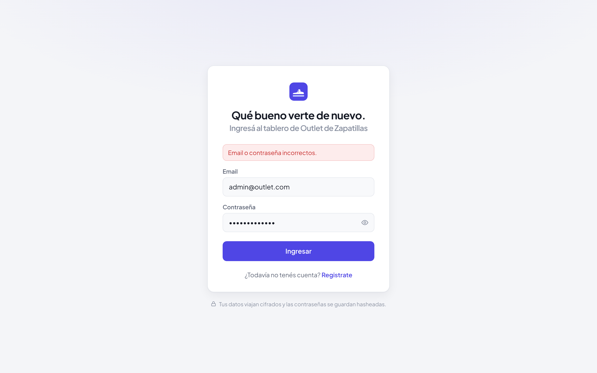
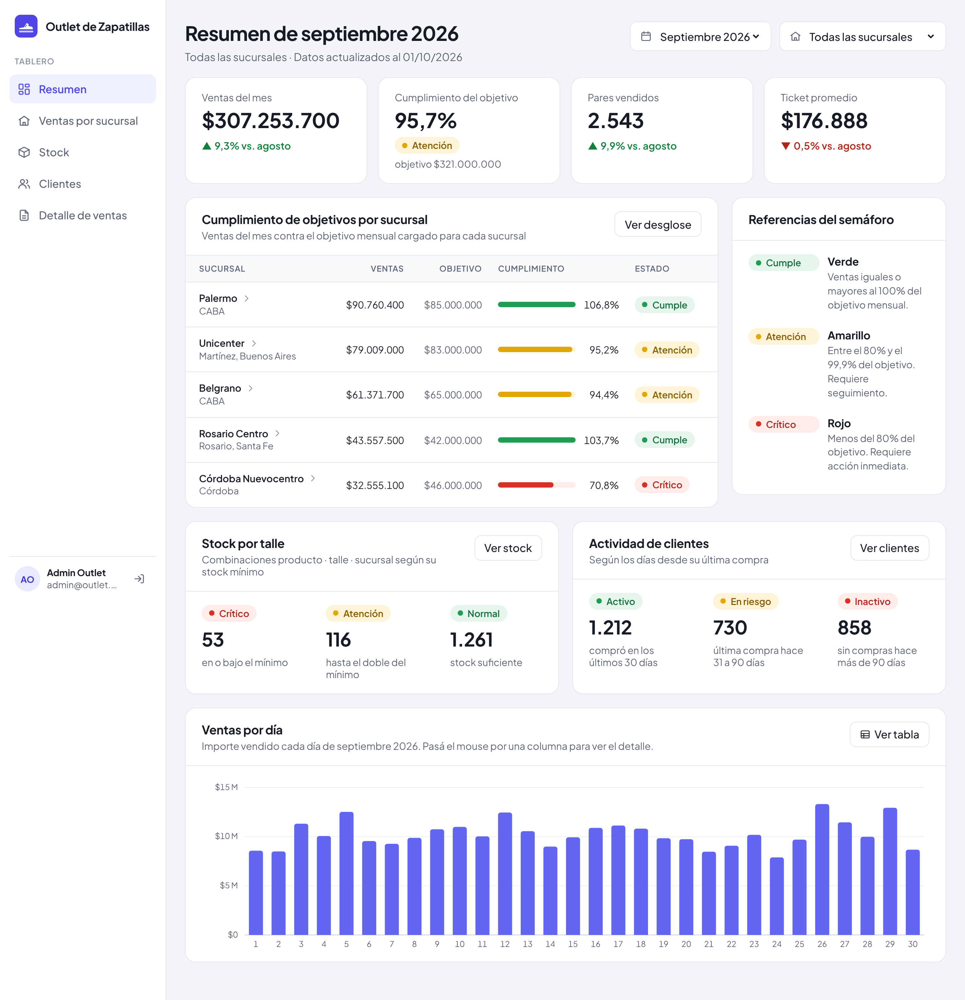
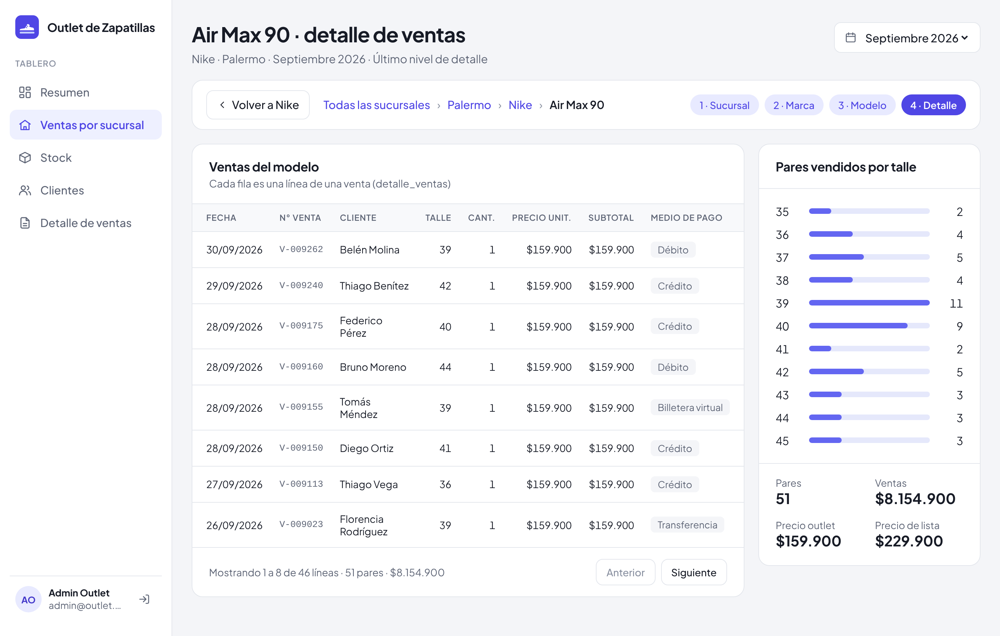

# Frontend del tablero de control

Interfaz web del tablero creada con **React 19**, **Vite** y **React Router**.
Se comunica por HTTP/JSON con la API de **ASP.NET Core** que está en
**`server/`**, según el contrato de **`docs/contrato-api.md`**.

## Contenido

- **Pantallas**:
  - Inicio de sesión (**`/login`**) y registro (**`/registro`**).
  - **Resumen** (**`/resumen`**): indicadores del mes con su variación,
    semáforo de cumplimiento por sucursal, estado del stock y de los clientes y
    gráfico de ventas por día. Se filtra por mes y por sucursal.
  - **Ventas por sucursal**, con drill down y drill up en cuatro niveles:
    **`/ventas`** (sucursales), **`/ventas/:idSucursal`** (marcas),
    **`/ventas/:idSucursal/:idMarca`** (modelos) y
    **`/ventas/:idSucursal/:idMarca/:idProducto`** (detalle de cada venta). Cada
    nivel tiene su URL, así que también funciona el botón atrás del navegador.
  - **Stock** (**`/stock`**), **Clientes** (**`/clientes`**) y **Detalle de
    ventas** (**`/detalle-ventas`**): tablas con filtros, búsqueda y paginación.
- **Semáforos**: el estado lo calcula el backend en SQL. El front lo muestra
  siempre con su texto y con la referencia de cada color en la misma pantalla.
- **Rutas protegidas**: el tablero solo se ve con sesión; login y registro,
  solo sin sesión. Cualquier otra ruta redirige a **`/resumen`** y, sin sesión,
  termina en **`/login`**. Si el backend rechaza el token, se cierra la sesión.
- **Validaciones** de formularios con las mismas reglas que el backend.
- Estructura de **`src/`**:
  - **`api/`**: llamadas HTTP (**`http.js`**), endpoints de autenticación
    (**`auth.js`**) y del tablero (**`tablero.js`**).
  - **`components/`**: barra lateral (**`AppLayout`**), semáforo y sus
    referencias, gráficos, filtros, paginación, navegación del drill down y
    piezas comunes del tablero.
  - **`context/`**: sesión del usuario (**`AuthProvider`**, **`useAuth`**) y
    datos compartidos del tablero (**`TableroProvider`**, **`useTablero`**):
    sucursales, marcas, meses con ventas y mes elegido.
  - **`hooks/`**: **`useApi`** (pide datos a la API y conserva los anteriores
    mientras recarga) y **`useAncho`**.
  - **`pages/`**: una página por pantalla; los cuatro niveles del drill down
    están en **`pages/ventas/`**.
  - **`styles/`**: estilos globales y tokens de color.
  - **`utils/`**: formato de números, importes y fechas (**`format.js`**),
    configuración de los semáforos (**`semaforo.js`**) y validaciones.
  - **`config.js`**: nombre de la app, URL de la API y filas por página.
- **`scripts/`**: capturas de pantalla y PDF de la entrega final.

## Requisitos previos

Para ejecutar el frontend se necesita:

- **Node.js 20** o superior.
- El **backend** corriendo (ver **`server/README.md`**).

## Configuración local

- Frontend: **`http://localhost:5173`**
- **`VITE_API_PROXY_TARGET`**: backend al que Vite redirige **`/api`** en
  desarrollo. Por defecto, **`http://localhost:5000`**.
- **`VITE_API_URL`**: prefijo de la API para builds de producción. Por defecto,
  **`/api`**.

Para instalar las dependencias, ejecutar **`npm install`**. Luego:

- **`npm run dev`**: servidor de desarrollo contra el backend.
- **`npm run build`**: versión de producción.
- **`npm run lint`**: revisión del código.

Para cambiar las variables sin tocar los archivos versionados, crear
**`.env.development.local`** (se puede copiar **`.env.example`**).

## Documento de la entrega final

El documento está en **`docs/entrega-2/documento.html`** y usa las capturas de
**`docs/img/entrega2/`**. Para regenerarlo:

1. La primera vez, instalar el navegador con
   **`npx playwright install chromium`**.
2. Con el front corriendo (**`npm run dev`** y el backend levantado), ejecutar
   **`npm run capturas`** en otra terminal. Saca de nuevo las capturas de todas
   las pantallas.
3. Ejecutar **`npm run pdf`**. Genera
   **`docs/Entrega 2 - Leonel Blumberg y Luciano Migoni.pdf`**.

También se puede abrir **`documento.html`** en Chrome e imprimirlo como PDF
(tamaño A4).

## Capturas

**Inicio de sesión**

**Inicio de sesión con credenciales incorrectas**

**Resumen del mes**

**Drill down, nivel 4: detalle de ventas del modelo**

## Autores

**Leonel Maximiliano Blumberg**

**Luciano Galo Migoni**
