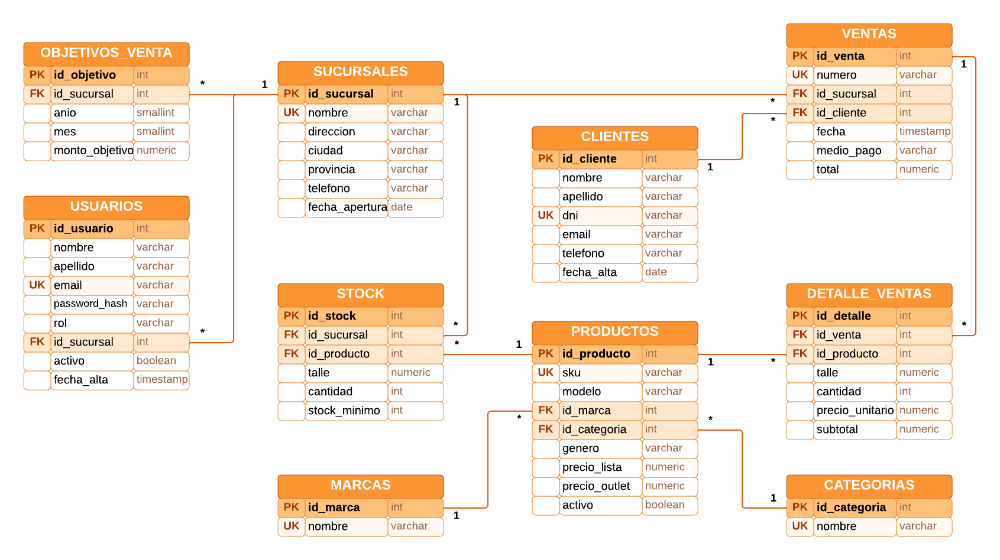

# Backend del tablero de control

API web creada con **ASP.NET Core** (C#, .NET 10) que valida el inicio de
sesión contra **PostgreSQL** y le entrega al tablero todos sus datos. El acceso
a datos es con **Npgsql** (ADO.NET), sin ORM: cada consulta es SQL escrito a
mano y parametrizado.

## Contenido

- **Endpoints de autenticación** (todas las respuestas son JSON):
  - **`POST /api/auth/login`**: recibe `{ email, password }` y devuelve
    `200 { token, usuario }`. Errores: `400` (datos incompletos), `401`
    (email o contraseña incorrectos) y `403` (cuenta deshabilitada).
  - **`POST /api/auth/register`**: recibe `{ nombre, apellido, email, password }`
    y devuelve `201 { token, usuario }`. Errores: `400` (datos inválidos) y
    `409` (ya existe una cuenta con ese email).
  - **`GET /api/auth/me`**: con el header `Authorization: Bearer <token>`
    devuelve el usuario. Sin un token válido responde `401`.
- **Endpoints del tablero**, todos con `Authorization: Bearer <token>`. Los
  parámetros y el JSON de cada uno están en **`docs/contrato-api.md`**:
  - **`GET /api/tablero/catalogos`**: meses con ventas, sucursales, marcas y
    fecha de referencia.
  - **`GET /api/tablero/resumen?anio&mes&idSucursal`**: indicadores del mes,
    cumplimiento por sucursal, conteos de stock y clientes por estado y ventas
    por día.
  - **`GET /api/ventas/sucursales?anio&mes`**: drill down, nivel 1.
  - **`GET /api/ventas/sucursales/{idSucursal}/marcas?anio&mes`**: nivel 2.
  - **`GET /api/ventas/sucursales/{idSucursal}/marcas/{idMarca}/modelos?anio&mes`**:
    nivel 3.
  - **`GET /api/ventas/sucursales/{idSucursal}/productos/{idProducto}?anio&mes&pagina&porPagina`**:
    nivel 4.
  - **`GET /api/stock?busqueda&idSucursal&idMarca&estado&pagina&porPagina`**.
  - **`GET /api/clientes?busqueda&idSucursal&estado&pagina&porPagina`**.
  - **`GET /api/ventas?desde&hasta&idSucursal&medioPago&busqueda&orden&pagina&porPagina`**.
- **Usuario** que devuelve la API: `{ id, nombre, apellido, email, rol }`. Nunca
  se devuelve el **`password_hash`**.
- **Errores** con el formato `{ message }`, en castellano, para que el frontend
  los muestre tal cual: `400` (parámetros inválidos), `401` (sin token o token
  vencido) y `404` (sucursal, marca o producto inexistente).
- **Semáforos** calculados en la base de datos con las funciones
  **`estado_objetivo`**, **`estado_stock`** y **`estado_cliente`**. Los días de
  los clientes se cuentan contra la fecha de referencia (el día siguiente a la
  última venta), no contra la fecha actual.
- **Contraseñas** guardadas con **`PasswordHasher<Usuario>`** de ASP.NET Core
  Identity: PBKDF2 con HMAC-SHA512, sal aleatoria de 128 bits y 100.000
  iteraciones. La contraseña nunca se guarda ni se devuelve.
- **Validaciones del registro**, iguales a las del frontend: nombre y apellido
  de 2 a 60 caracteres, email válido y único de hasta 120 caracteres (se guarda
  en minúsculas) y contraseña de 8 a 100 caracteres que combine letras y
  números.
- **Scripts SQL** en **`base de datos/`**:
  - **`01_crear_tablas.sql`**: tablas del DER con sus PK, FK, UNIQUE y CHECK.
  - **`02_siembra_usuarios.sql`**: cuentas de prueba con la contraseña
    hasheada.
  - **`03_siembra_datos.sql`**: datos de prueba con `INSERT` (5 sucursales, 26
    productos, 1.430 registros de stock, 2.800 clientes, 30 objetivos, 9.308
    ventas y 12.386 líneas de detalle, de abril a septiembre de 2026).
  - **`04_vistas_y_funciones.sql`**: funciones de los semáforos y las vistas
    **`vista_stock`** y **`vista_actividad_clientes`**.
- Estructura de **`OutletApi/`**:
  - **`Controllers/`**: **`AuthController`** (login, registro y sesión),
    **`TableroController`** (catálogos y resumen), **`VentasController`** (drill
    down y detalle de ventas), **`StockController`** y **`ClientesController`**.
  - **`Data/`**: un repositorio por tema con sus consultas SQL
    (**`UsuariosRepository`**, **`CatalogosRepository`**, **`VentasRepository`**,
    **`StockRepository`** y **`ClientesRepository`**), **`SqlExtensions`**
    (parámetros y lectura de columnas) y **`DatabaseInitializer`** (crea la base
    y ejecuta los scripts al arrancar).
  - **`Services/TokenService.cs`**: genera el token JWT.
  - **`Models/`**: fila de usuarios, período y paginación de las consultas.
  - **`Dtos/`**: cuerpos y respuestas de la API.
  - **`Program.cs`**: configuración de la conexión, el JWT y el
    PasswordHasher.

## Requisitos previos

Para ejecutar el backend se necesita:

- **.NET SDK 10**.
- **PostgreSQL** (probado con las versiones 16 y 17) corriendo en
  **`localhost:5432`**.

Las tablas se crean ejecutando los scripts SQL de **`base de datos/`**: no se
usan migraciones ni **`dotnet ef database update`**.

## Configuración local

Valores de desarrollo, en **`OutletApi/appsettings.Development.json`**:

- Conexión (**`ConnectionStrings:Outlet`**):
  **`Host=localhost;Port=5432;Database=outlet_zapatillas;Username=postgres;Password=postgres`**
- Clave del JWT (**`Jwt:Key`**, 32 caracteres o más):
  **`clave-de-desarrollo-outlet-zapatillas`**
- Duración de la sesión (**`Jwt:ExpiraHoras`**): **`8`** horas
- API: **`http://localhost:5000`**

Para levantar la API, ejecutar **`dotnet run`** dentro de **`OutletApi`**. Al
arrancar, crea la base **`outlet_zapatillas`** si no existe y ejecuta los cuatro
scripts de **`base de datos/`**, en orden y dentro de una transacción. Los
scripts se pueden correr varias veces sin duplicar nada. Para no inicializar la
base al arrancar, poner **`Database:InicializarAlArrancar`** en **`false`**: los
scripts también se pueden ejecutar a mano desde psql o pgAdmin.

Si el usuario **`postgres`** tiene otra contraseña, no cambiar el archivo
versionado: usar los secretos de usuario de .NET, que quedan fuera del
repositorio. Para eso, dentro de **`OutletApi`**, ejecutar
**`dotnet user-secrets init`** y luego el siguiente comando, reemplazando
**`TU_CONTRASEÑA`** por la contraseña real:

**`dotnet user-secrets set "ConnectionStrings:Outlet" "Host=localhost;Port=5432;Database=outlet_zapatillas;Username=postgres;Password=TU_CONTRASEÑA"`**

Con **`dotnet user-secrets list`** se puede verificar el valor guardado.

Para sembrar un usuario nuevo, generar el hash de su contraseña con
**`dotnet run -- hash <contraseña>`** y copiarlo en
**`base de datos/02_siembra_usuarios.sql`**.

Para probar la API sin el frontend, enviar un **`POST`** a
**`http://localhost:5000/api/auth/login`** con el cuerpo
**`{"email":"admin@outlet.com","password":"Admin1234"}`** (por ejemplo, con
curl o Postman) y usar el **`token`** que devuelve en el header
**`Authorization: Bearer <token>`** de los endpoints del tablero.

## Capturas

**Diagrama entidad-relación de la base de datos**

## Autores

**Leonel Maximiliano Blumberg**

**Luciano Galo Migoni**
